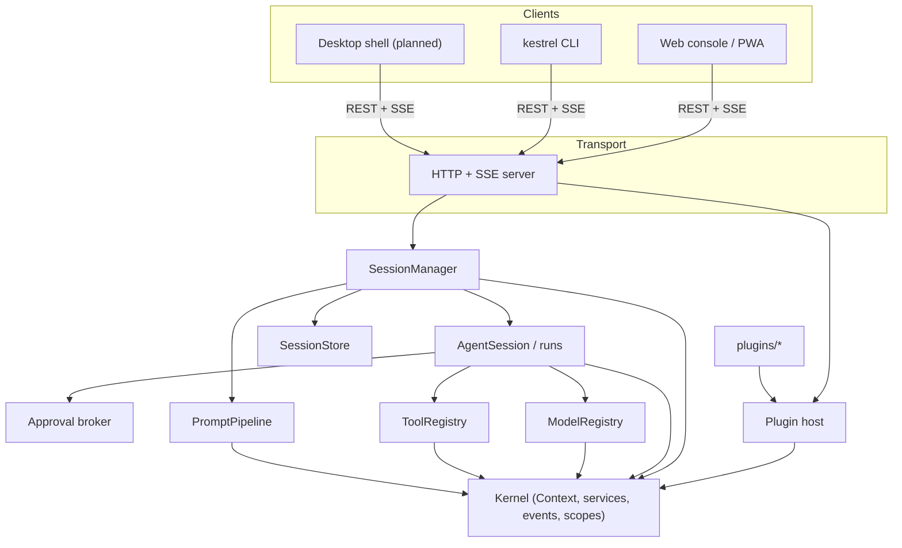
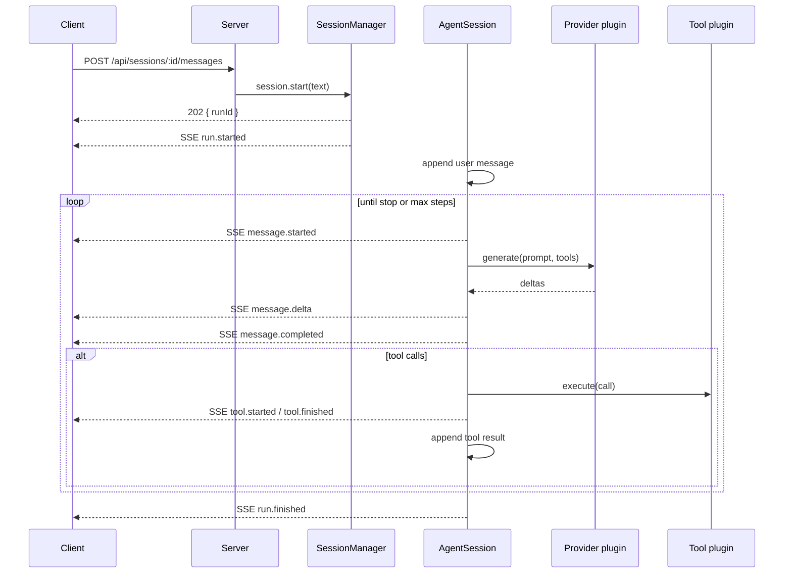

# Architecture

Kestrel is four libraries and two clients. The boundaries are deliberate: the kernel has no
knowledge of models, the runtime has no knowledge of HTTP, and the server has no knowledge of
prompts.



## Layers

### Kernel

`@kestrel/kernel` is the smallest layer and the one everything else depends on. It provides:

- **Context** — a named node in a tree. Every plugin gets a child context.
- **Services** — named values with an owner and a disposer. Plugin contributions land in the
  application-wide registry; lookups fall through the parent chain.
- **Injection** — `context.inject(["tools"], callback)` runs the callback when all dependencies are
  present and disposes its result if one disappears.
- **Events** — typed `on`/`emit` with `service/provided`, `service/removed`, `plugin/loading`,
  `plugin/active`, `plugin/error` and `plugin/disposed`.
- **Scope** — an ordered bag of disposers. Scopes are hierarchical and unwind in reverse order.
- **Logger** — structured records with a context label and level filtering.

The kernel is roughly a thousand lines. It has no I/O and no dependencies.

### Protocol

`@kestrel/protocol` contains data definitions only: session summaries, chat messages, tool schemas,
events and endpoint constants. It is compiled by the server, the browser console and the CLI, which
is why the same event union type-checks on both sides of the wire.

### Runtime

`@kestrel/agent` owns the agent loop:

1. `SessionManager` creates sessions, holds transcripts and publishes events.
2. `AgentSession` appends a user message, builds the prompt and starts a run.
3. A run calls the selected model, streams deltas, executes tool calls one at a time, appends
   results, and repeats until the model stops or the step budget is exhausted.
4. `ModelRegistry` and `ToolRegistry` are ordinary service objects; providers and tool packs
   register into them from plugins.
5. `PromptPipeline` composes the system prompt from ordered layers supplied by plugins — workspace
   instructions, policies or skills — so changing agent behaviour does not mean editing the loop.
6. `FileSessionStore` persists transcripts to disk after each message, with serialized, atomic writes.

The runtime never touches the network directly. It calls a `LanguageModel` implementation supplied
by a plugin.

### Plugin host

`@kestrel/plugin-host` turns directories into running plugins:

- Discovery reads `kestrel.plugin.json`, or `package.json` with a `kestrel` field.
- Dependency resolution produces a stable topological order; cycles and missing dependencies are
  recorded as plugin errors.
- Loading imports the entry module, merges manifest config with user config, calls
  `context.plugin(definition, config)` and waits for `ready()` with a timeout.
- Disposal runs in reverse order and marks plugins `disposed`.

### Server

`@kestrel/server` is an adapter. It parses requests, validates bodies, enforces auth and body
limits, maps errors to JSON, streams SSE, and serves the built console. It also owns the runtime
lifecycle: load config, build the kernel, load plugins, start sessions, and shut down cleanly on
signals.

### Clients

The web console and CLI are independent consumers of the protocol. The console adds a session
sidebar, streaming markdown, tool cards and approval dialogs. The CLI renders the same events as
text. Neither imports the runtime.

## The lifetime of a run



The HTTP response returns before the model is called. Everything else arrives on the event stream.
This keeps long runs from timing out in proxies and lets a client disconnect without cancelling the
run.

## Session persistence

```
.kestrel/
  memory.json                 # notes written by the memory plugin
  sessions/
    <session-id>/
      session.json            # summary + transcript + system prompt
```

Writes are debounced and atomic: a temporary file is written and then renamed. The `SessionStore`
interface is small enough to replace with SQLite, Redis or an object store.

## Why these boundaries

- **Testability.** The runtime is exercised with a scripted model and a fake tool, without a server.
- **Portability.** The server is Node-only today, but the protocol is not. Another implementation
  could serve the same clients.
- **Replaceability.** Every capability is a service. If you dislike the built-in shell tool, provide
  `tools` yourself; if you need a different store, provide a different `SessionStore`.
- **Observability.** Because every registration is scoped, the kernel can report which plugin owns a
  service, a listener or a timer.

## Known trade-offs

- Plugins share a process, so a malicious plugin can do anything the process can do. Sandboxing is
  an operational concern, not a kernel guarantee. See [Security](/guide/security).
- The event buffer is in memory, bounded and per-process. Horizontal scaling requires a shared bus,
  which is not implemented yet.
- The console is served as static files; plugins cannot yet contribute UI bundles. The manifest has
  a reserved `web` field for that.
