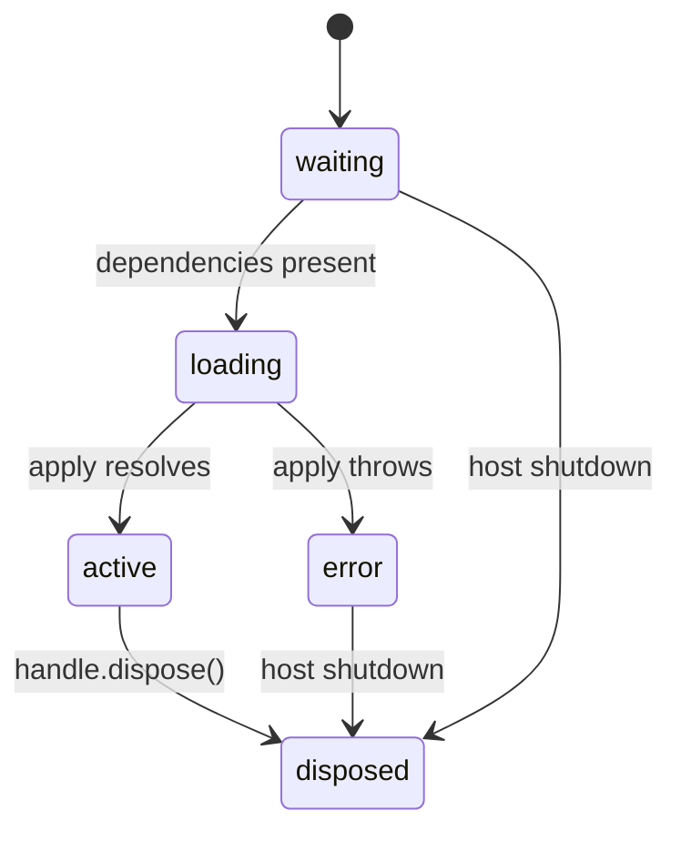

# The plugin system

A Kestrel plugin is a directory with a manifest and an ES module. The host does not know what the
plugin does; it only knows how to start it, wait for it, and stop it. That ignorance is what keeps
the platform open-ended.

## Anatomy

```
plugins/my-plugin/
  kestrel.plugin.json   # or a "kestrel" field in package.json
  dist/index.js         # or src/index.ts during development
```

```json
{
  "name": "@acme/plugin-database",
  "version": "1.2.0",
  "description": "Adds read-only SQL tools backed by a connection pool.",
  "entry": "dist/index.js",
  "requires": ["@kestrel/plugin-tools-core"],
  "inject": ["tools"],
  "config": {
    "maxRows": 200
  }
}
```

| Field | Meaning |
| --- | --- |
| `name` | Stable identity. Used for configuration, allow-lists and dependency references. |
| `version` | Semver. Reported by `/api/bootstrap` and the CLI. |
| `description` | Human-readable summary shown in the console. |
| `entry` | Module path relative to the directory. Defaults to `dist/index.js`, then `src/index.ts`, then `index.js`. |
| `requires` | Plugin names that must be **loaded and active first**. |
| `inject` | **Service keys** that must exist before `apply` runs. |
| `config` | Defaults, merged with the user configuration for this plugin. |
| `web` | Reserved: a browser bundle path for future console extensions. |

`requires` and `inject` solve different problems. `requires` orders plugins; `inject` waits for
capabilities. A plugin that only needs the `tools` service should use `inject` and does not care
which plugin provides it. A plugin that ships a companion — a database driver and the tools that
use it — should use both.

## Module shape

The entry module may export a plugin object as `default`, `plugin` or `kestrelPlugin`, or export an
`apply` function directly:

```ts
import type { PluginDefinition } from "@kestrel/kernel";

export default {
  name: "@acme/plugin-database",
  version: "1.2.0",
  inject: ["tools"],
  async apply(context, config) {
    // register everything here
  },
} satisfies PluginDefinition<{ maxRows?: number }>;
```

A bare function is treated as `apply`, with identity taken from the manifest:

```js
export default function apply(context, config) {
  context.logger.info("hello", { config });
}
```

## Lifecycle



- **waiting** — discovered, dependencies not yet satisfied.
- **loading** — the module is imported and `context.plugin()` has been called.
- **active** — `apply` has resolved. `handle.ready()` resolves at this point.
- **error** — `apply` threw or the timeout elapsed. The message is kept in `PluginInfo.error`.
- **disposed** — every disposer registered by the plugin has run.

`PluginHost.loadAll()` skips plugins already in `error`, so one broken extension does not prevent
the rest from starting. Missing dependencies and cycles are detected during discovery and reported
the same way.

## Contexts and services

Every plugin receives a **child context**. It can:

```ts
context.provide("search", implementation);       // publish a service
context.get("tools");                            // consume a service
context.has("memory");
context.inject(["tools"], async (ctx) => {       // react to availability
  const dispose = ctx.get("tools").register(tool);
  return dispose;                                // called if `tools` disappears
});
context.on("service/provided", (key, value) => {});
context.effect(() => subscribe());               // run now, dispose with the plugin
context.plugin(childDefinition, childConfig);    // compose another plugin
context.logger.info("...");
```

Services provided by a plugin are installed in the **application-wide registry**, so every other
plugin can consume them, while ownership and disposal stay with the contributing plugin. When the
plugin is disposed, its services, listeners, injectors and child plugins are removed in reverse
order.

Providing a key that already exists throws unless the provider is the same context or you pass
`{ replace: true }`. This is intentional: two plugins silently fighting over `tools` is a bug, not
a feature.

### Built-in services

| Key | Provided by | What it offers |
| --- | --- | --- |
| `log` | kernel | Structured logger. |
| `models` | `@kestrel/agent` | Model registry. Providers add `LanguageModel` instances. |
| `tools` | `@kestrel/agent` | Tool registry. Tools are what the model can call. |
| `sessions` | `@kestrel/agent` | Session lifecycle, events and persistence. |
| `prompts` | `@kestrel/agent` | Ordered layers over the system prompt. |
| `plugins` | `@kestrel/plugin-host` | Discovery, loading and status. |
| `skills` | `@kestrel/plugin-skills` | Workspace skill catalogue (`list`, `load`). |
| `memory` | `@kestrel/plugin-memory` | Durable workspace notes. |
| `mcp` | `@kestrel/plugin-mcp` | Connected MCP servers and their tools. |
| `subagents` | `@kestrel/plugin-subagents` | Delegation roles and the running subagent set. |
| `storage` | `@kestrel/server` | Data directory and path helper for plugin-owned files. |
| `http.routes` | `@kestrel/server` | Register extra JSON endpoints under `/api/`. |
| `sandbox` | `@kestrel/plugin-sandbox-docker` | Optional command executor; the shell tool uses it when present. |

### Prompt layers

The system prompt is a pipeline, not a string assembled in one place. A layer receives the prompt
produced so far plus the workspace, session id and tool names, and returns a new prompt. Layers run
synchronously when a session is created, in `order` (ties keep registration order). A throwing layer
is logged and skipped, so a broken context source cannot prevent sessions from starting.

```ts
export default {
  name: "@acme/plugin-policy",
  version: "1.0.0",
  inject: ["prompts"],
  apply(context) {
    context.effect(() =>
      context.get("prompts").add({
        name: "acme-policy",
        order: 100,
        transform: (prompt, { workspace }) =>
          `${prompt}\n\n## Policy\n\nNever edit files under ${workspace}/vendor.`,
      }),
    );
  },
};
```

`@kestrel/plugin-context` is the reference implementation: it reads `AGENTS.md` (then
`.kestrel/AGENTS.md` and `.cursorrules`) from the session workspace and appends it as untrusted
project guidance. `@kestrel/plugin-skills` uses the same seam at `order: 60` to list available
workspace skills, keeping their bodies out of the prompt until the model asks for one
(see [Skills](/guide/skills)). Layers are not re-rendered on every turn; edit the workspace file and
start a new session to pick up changes.

## Order independence

`inject` makes plugins order-independent. The host may load `memory` before `tools-core`; the kernel
holds the injection until `tools` exists, then runs it. If `tools` is later removed — because its
plugin was disposed — the injection is torn down. This is what allows live plugin replacement
without restarting the process.

```ts
export default {
  name: "@acme/plugin-audit",
  version: "1.0.0",
  inject: ["tools"],
  apply(context) {
    context.inject(["models"], (ctx) => {
      const dispose = ctx.get("tools").register(auditTool);
      context.logger.info("audit tool installed");
      return dispose;
    });
  },
};
```

## Configuration

Configuration is merged in this order:

1. `config` in the manifest (defaults shipped with the plugin).
2. `plugins.config["<plugin name>"]` from `kestrel.config.json`.
3. Environment overrides applied by the server (see [Configuration](/reference/config)).

The merged object is passed as the second argument to `apply`. Secrets should be referenced by
environment variable name rather than embedded in configuration:

```ts
const key = config.apiKey ?? process.env[config.apiKeyEnv ?? "ACME_API_KEY"] ?? "";
```

## Discovery

`KESTREL_PLUGINS=plugins,examples/plugins` lists directories to scan. Each immediate subdirectory
is inspected; `node_modules` and dot-directories are skipped. Duplicate names are ignored with a
warning — the first directory wins.

`plugins.allow` restricts loading to an explicit list, which is useful when a writable directory is
mounted into a container:

```json
{ "plugins": { "allow": ["@kestrel/plugin-openai", "@kestrel/plugin-tools-core"] } }
```

`applyTimeoutMs` (default 20 s) prevents a plugin that never settles from blocking startup.

## Failure isolation

- Import errors and `apply` rejections mark the plugin `error` and log the message.
- Dependents of a failed plugin are not started.
- Disposal errors are logged and do not stop the remaining teardown.
- The rest of the runtime keeps serving sessions.

## Writing plugins in plain JavaScript

No build step is required. This repository ships three examples:

- `examples/plugins/echo-model` — registers a deterministic offline model.
- `examples/plugins/clock-tool` — injects `tools` and contributes one tool, without importing the
  tools plugin.
- `examples/plugins/web-metrics` — adds a browser bundle that renders in the console sidebar and
  settings drawer. See [Plugin UI](/guide/plugin-ui).

Both are under a hundred lines and are loaded by `KESTREL_PLUGINS=plugins,examples/plugins`. They
are the fastest way to see service injection in action.
