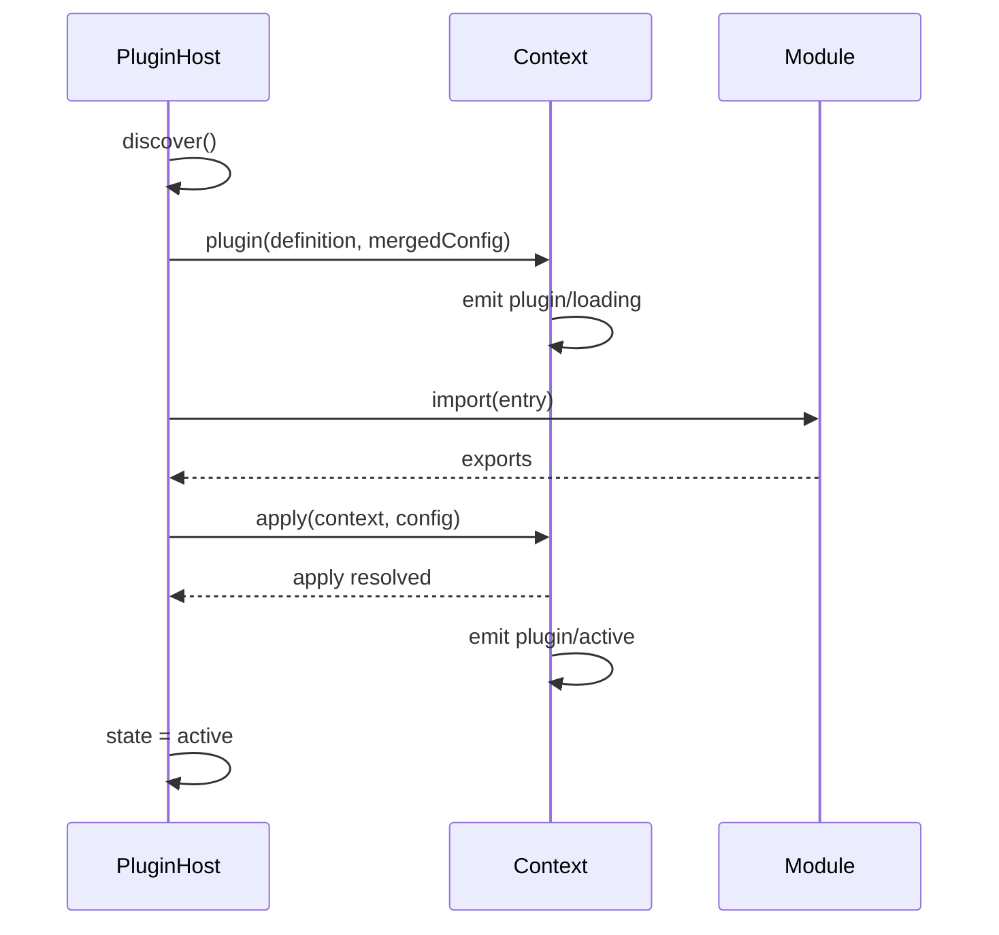

# Plugin reference

Package: `@kestrel/plugin-host`.

The host discovers manifests, resolves dependencies, imports entries and tracks lifecycle state. It
does not know what a plugin does.

## `PluginHost`

```ts
interface PluginHostOptions {
  context: Context;
  logger: Logger;
  directories?: string[];
  entries?: Array<{ manifest: PluginManifest; entry: string; source?: PluginInfo["source"] }>;
  config?: Record<string, Record<string, unknown>>;
  allow?: string[];
  applyTimeoutMs?: number;   // default 20_000
}

class PluginHost {
  constructor(options: PluginHostOptions);
  discover(): Promise<PluginInfo[]>;
  loadAll(): Promise<PluginInfo[]>;
  load(name: string): Promise<PluginInfo>;
  dispose(): Promise<void>;
  list(): PluginInfo[];
  get(name: string): PluginInfo | undefined;
  directories(): string[];
}
```

| Method | Behaviour |
| --- | --- |
| `discover()` | Scans directories, reads manifests, validates names and builds the dependency graph. Does not import code. |
| `loadAll()` | Loads every waiting plugin in dependency order, skipping plugins already active or in error. Resolves to the final state list. |
| `load(name)` | Loads one plugin and its unmet dependencies. Throws if the plugin is unknown or cannot start. |
| `dispose()` | Disposes handles in reverse load order and marks plugins `disposed`. |
| `list()` | Current `PluginInfo[]`, including errors and paths. |
| `get(name)` | One `PluginInfo`, or `undefined`. |
| `directories()` | The configured scan roots as given. |

`loadAll()` never rejects because one plugin failed; failures are reported in the returned
`PluginInfo.error` and through the `plugin/error` event.

## Manifest

```ts
interface PluginManifest {
  name: string;
  version: string;
  description?: string;
  entry?: string;                 // default: dist/index.js, then src/index.ts, then index.js
  requires?: string[];            // plugin names
  inject?: string[];              // service keys
  config?: Record<string, unknown>;
  web?: string;                   // reserved
}
```

Manifest resolution, in order:

1. `<dir>/kestrel.plugin.json`.
2. `<dir>/package.json` → `kestrel` field, merged with `name`, `version`, `description` and `main`.
3. Otherwise the directory is ignored.

`entry` must stay inside the plugin directory. The host resolves it against the directory and uses
`pathToFileURL` for dynamic import.

### Discovery rules

- Only immediate subdirectories are scanned.
- `node_modules`, dot-directories and directories without a manifest are skipped.
- Duplicate names: the first occurrence wins and a warning is logged.
- `allow`, when set, is an exact allow-list by manifest name; all others are skipped.
- Missing plugin directories log a warning and are ignored.

### Dependency resolution

`requires` edges are resolved transitively. The order is stable: discovery order is preserved among
independent plugins. Missing dependencies and cycles produce `state: "error"` with a message naming
the plugin and the missing or cyclic edge; dependents are not started.

`inject` does **not** affect load order. It is enforced by the kernel at `apply` time, which is why
plugins can be loaded in any order and still receive their services.

## Module contract

The imported module may export:

| Export | Interpretation |
| --- | --- |
| `default` | Plugin definition (object with `apply`) or a bare `apply` function. |
| `plugin` | Same, checked when `default` is absent. |
| `kestrelPlugin` | Same, checked last. |
| `apply` | A function treated as `apply`; name/version come from the manifest. |

A definition object's `name`, `version`, `description` and `inject` override the manifest when
present; the manifest fills in whatever the definition omits. Keep them equal to avoid confusing
`/api/plugins` output.

## Loading sequence



If `apply` exceeds `applyTimeoutMs`, the plugin is marked `error`; its disposers still run on
disposal. The timeout does not kill an in-flight promise, so plugins should honour cancellation or
finish quickly.

## Configuration merge

```
{ ...manifest.config, ...userConfig[manifest.name] }
```

The merged object is passed to `apply`. User configuration wins at the top level; nested objects are
not deep-merged.

## `PluginInfo`

```ts
interface PluginInfo {
  id: string;                 // manifest name
  name: string;
  version: string;
  description?: string;
  state: "waiting" | "loading" | "active" | "error" | "disposed";
  dependencies: string[];
  error?: string;
  source: "builtin" | "local" | "package";
  path?: string;              // absolute path when discovered from disk
}
```

`source` is `builtin` for entries supplied through `options.entries`, otherwise `local` for scanned
directories (the server uses `local` for all on-disk plugins today; `package` is reserved for a
future registry).

## Errors

| Situation | Result |
| --- | --- |
| Manifest is invalid JSON | Plugin is skipped with a warning. |
| `name` or `version` missing | Plugin is skipped with a warning. |
| Entry module missing | `state: "error"`, message includes the path. |
| No recognised export | `state: "error"`, message lists expected exports. |
| `apply` throws | `state: "error"`, message is the error message. |
| `apply` times out | `state: "error"`, message names the timeout. |
| Missing dependency / cycle | `state: "error"`, dependents remain `waiting`. |

Errors are visible in `GET /api/plugins`, the console's plugin panel and `kestrel plugins`.
